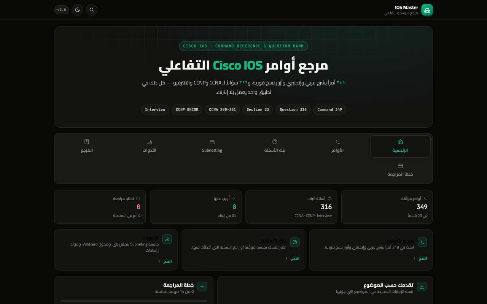

# IOS Master — مرجع Cisco IOS التفاعلي

> مرجع عربي تفاعلي لأوامر **Cisco IOS** مع شرح عربي وإنجليزي لكل أمر، وبنك أسئلة شامل لشهادات **CCNA 200-301** و**CCNP ENCOR 350-401** وأسئلة الانترفيو.
> يعمل بلا إنترنت، وقابل للتثبيت على الجوال كتطبيق (PWA).



---

## ما الموجود داخل الموقع

| القسم | المحتوى |
|---|---|
| **الأوامر** | **٣٤٩ أمراً** في **٢٣ قسماً** — كل أمر بـ: الصيغة، وضع الـ CLI، شرح عربي، شرح إنجليزي، مثال تطبيقي، الأمر العكسي، وزر نسخ فوري |
| **بنك الأسئلة** | **٣١٦ سؤالاً** — ٢٠٥ CCNA + ٦٩ CCNP ENCOR + ٤٢ انترفيو (١٥٦ اختيار متعدد + ١٦٠ سؤالاً مفتوحاً بإجابات نموذجية) |
| **حاسبة Subnetting** | صفحة مخصّصة (٦ أقسام): محلّل الشبكة، مقسّم FLSM، تخطيط VLSM، أدوات التحويل، مرجع دراسي، وحاسبة IPv6 — مع تمثيل بصري ٣٢-بت وتحقق كامل |
| **الأدوات** | محوّل قناع/Wildcard/CIDR، مولّد كلمات سر، مولّد إعداد تصليب جاهز للصق |
| **المرجع** | ١٣ جدول بحث سريع: المنافذ، المسافة الإدارية، CIDR، أنواع LSA، حالات BGP، Syslog، مؤقتات STP، DSCP، مقارنة بروتوكولات التوجيه، معايير الكابلات، أنواع عناوين IPv6، أوضاع EtherChannel، شروط تكوينها |
| **خطة المراجعة** | خطة ١٤ يوماً + ١٠ تمارين معملية، مع حفظ التقدّم |

### المميزات

- **وضعان للاختبار**: اختبار مُوقَّت (اختيار متعدد بتصحيح تلقائي) وتدريب مع الشرح (تقييم ذاتي للأسئلة المفتوحة).
- **بحث سريع** بالضغط على `/` يبحث في الأوامر والأسئلة معاً، مع تنقّل بلوحة المفاتيح.
- **حفظ الأسئلة والمفضلة** للمراجعة لاحقاً، وإحصاءات لكل موضوع تُظهر أضعف النقاط.
- **ثيمان** فاتح وداكن، وواجهة عربية RTL كاملة مع عزل صحيح للأوامر الإنجليزية.
- **متجاوب** حتى شاشة ٤٣٠px، و**يعمل بلا إنترنت** بعد أول زيارة (Service Worker).
- **بلا أي إطار عمل أو اعتماد** خارج خطوط Google — كل شيء HTML/CSS/JS خالص.

---

## التشغيل محلياً

لا يحتاج أي بناء أو تثبيت:

```bash
# الأسهل: افتح الملف مباشرة
start index.html          # Windows
open index.html           # macOS

# أو شغّل سيرفراً محلياً (مستحسن لتجربة الـ PWA)
python -m http.server 8000
# ثم افتح http://localhost:8000
```

> ملاحظة: فتح الملف مباشرة (`file://`) يعمل بالكامل بما فيه النسخ، لكن الـ Service Worker (العمل بلا إنترنت) يحتاج `http://` أو `https://`.

---

## النشر على GitHub Pages

### الطريقة الأولى — من واجهة GitHub (بدون أوامر)

1. أنشئ مستودعاً جديداً باسم `ios-master` واجعله **Public**.
2. اضغط **Add file → Upload files** واسحب **محتويات** المجلد المضغوط (لا المجلد نفسه).
3. تأكد أن `index.html` في **جذر** المستودع.
4. اذهب إلى **Settings → Pages**، واختر:
   - **Source**: `Deploy from a branch`
   - **Branch**: `main` / المجلد `/ (root)`
5. انتظر دقيقة، وسيظهر الموقع على:
   `https://<username>.github.io/ios-master/`

### الطريقة الثانية — من الطرفية (git)

```bash
cd ios-master
git init
git add .
git commit -m "IOS Master: interactive Cisco IOS reference + question bank"
git branch -M main
git remote add origin https://github.com/<username>/ios-master.git
git push -u origin main
```

ثم فعّل Pages من **Settings → Pages** كما في الخطوة ٤.

### تحديث الموقع بعد أي تعديل

```bash
git add .
git commit -m "update content"
git push
```

> إن ظهرت نسخة قديمة بعد التحديث، فذلك من الـ Service Worker: افتح الموقع مرة أخرى أو امسح بيانات الموقع من إعدادات المتصفح. وللتحكم اليدوي، غيّر رقم `CACHE` في `sw.js`.

---

## هيكل الملفات

```
ios-master/
├── index.html                  ← نقطة الدخول (كل الصفحات SPA)
├── 404.html                    ← صفحة الخطأ
├── manifest.webmanifest        ← بيانات تطبيق الـ PWA
├── sw.js                       ← Service Worker (العمل بلا إنترنت)
├── robots.txt
├── .nojekyll                   ← يمنع معالجة Jekyll على GitHub Pages
├── assets/
│   ├── app.css                 ← نظام التصميم (ثيمان + RTL)
│   ├── core.js                 ← الحالة، التخزين، التوجيه، الحافظة
│   ├── boot.js                 ← الربط، البحث السريع، تسجيل الـ SW
│   ├── view-commands.js        ← صفحة الأوامر
│   ├── view-questions.js       ← بنك الأسئلة ومحرّك الاختبار
│   ├── view-tools.js           ← الأدوات
│   ├── view-misc.js            ← الرئيسية + المرجع + الخطة
│   ├── data-commands.js        ← بيانات الأوامر (مولّدة)
│   ├── data-questions.js       ← بيانات الأسئلة (مولّدة)
│   ├── favicon.svg · icon-192.png · icon-512.png · og.png
├── docs/                       ← لقطات الشاشة للـ README
├── Cisco-IOS-Commands-AR.html  ← النسخة المطبوعة (قابلة للطباعة/PDF)
└── Cisco-IOS-Commands-AR.pdf   ← نسخة PDF جاهزة
```

**لا تعدّل** `data-commands.js` أو `data-questions.js` يدوياً — فهي مولّدة من المستند المطبوع عبر سكربتات في مجلد `build/` (غير مرفوع مع الموقع).

---

## المحتوى العلمي

- يغطّي منهج **CCNA 200-301** كاملاً: الأساسيات، العنونة، VLANs وSTP، الأمان، التوجيه، الخدمات، الأتمتة، واللاسلكي.
- ويتوسّع إلى مستوى **CCNP ENCOR 350-401**: أنواع LSA وNSSA، EIGRP named mode، اختيار مسار BGP وRoute Reflectors، MST وRoot Guard، Private VLAN، CoPP، AAA، YANG/NETCONF/RESTCONF، VXLAN، MPLS L3VPN، SD-WAN، ZBFW، MACsec.
- أسئلة الانترفيو مكتوبة كسيناريوهات تشخيص حقيقية (OSPF عالق في EXSTART، عاصفة بث، `169.254.x.x`، `err-disabled`…).

---

## English

**IOS Master** is an offline-first, bilingual (Arabic/English) interactive reference for Cisco IOS.

- **349 commands** across 23 sections — each with syntax, CLI mode, Arabic and English explanations, a real configuration example, the negating command, and one-click copy.
- **316 questions** (CCNA 200-301 · CCNP ENCOR 350-401 · interview) with a timed exam mode, a practice mode with self-grading, and per-topic progress tracking.
- **Subnetting module** — a dedicated page with six calculators: network analyzer (with a 32-bit binary visualiser, block-size cheats and a quick "how to compute" note), FLSM divider, VLSM planner (with waste/efficiency analysis), IP format/representation tools, a study reference (CIDR table, private ranges, subnetting cheatsheet), and an IPv6 section (address types, SLAAC/`eui-64`, /64 count, and subnet splitter).
- **Tools**: mask/wildcard/CIDR converter, password generator that always satisfies Cisco complexity, and a hardening config builder.
- **13 searchable reference tables** (ports, AD, CIDR, OSPF LSAs, BGP states, syslog, STP, DSCP, routing comparison, cabling, IPv6 address types, EtherChannel modes and requirements), a 14-day study plan, and 10 hands-on labs.
- **Shareable deep links** — every command and question has a stable URL (`#commands/c150`, `#questions/q250`) that opens straight to it.
- Vanilla HTML/CSS/JS — no framework, no build step. Deploy by pushing the folder to GitHub Pages.

```bash
git clone https://github.com/<username>/ios-master.git
cd ios-master && python -m http.server 8000
```

---

## الترخيص

[MIT](LICENSE) — الاستخدام والتعديل والتوزيع مسموح مع الإشارة للمصدر.

> المحتوى تعليمي واجتهاد شخصي، وليس وثيقة رسمية من Cisco. أسماء المنتجات والعلامات التجارية ملك لأصحابها.
